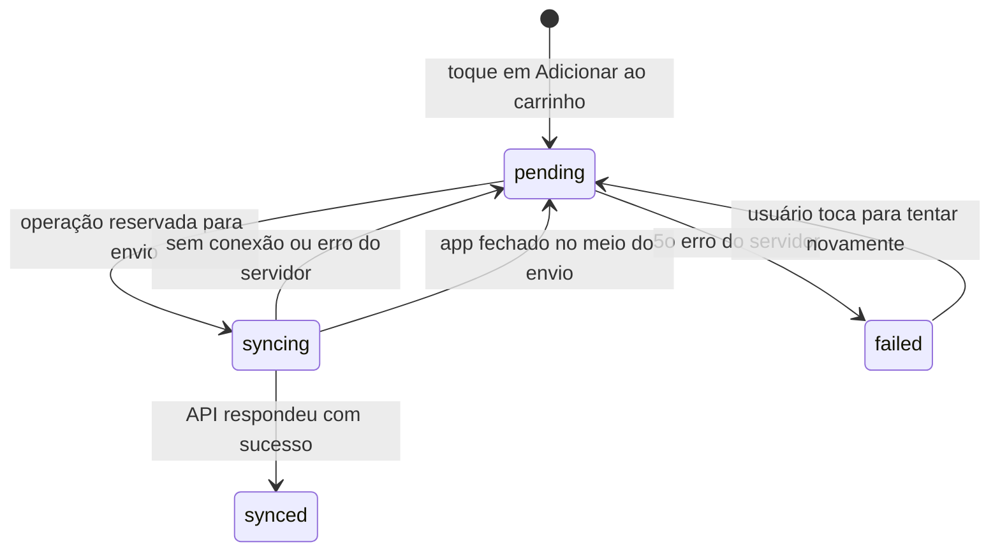
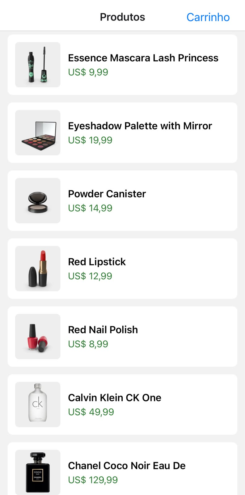
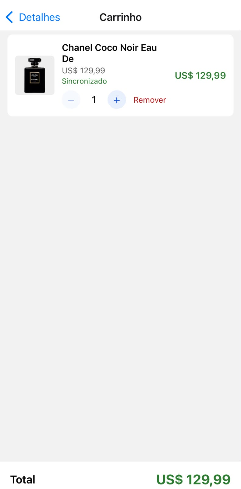
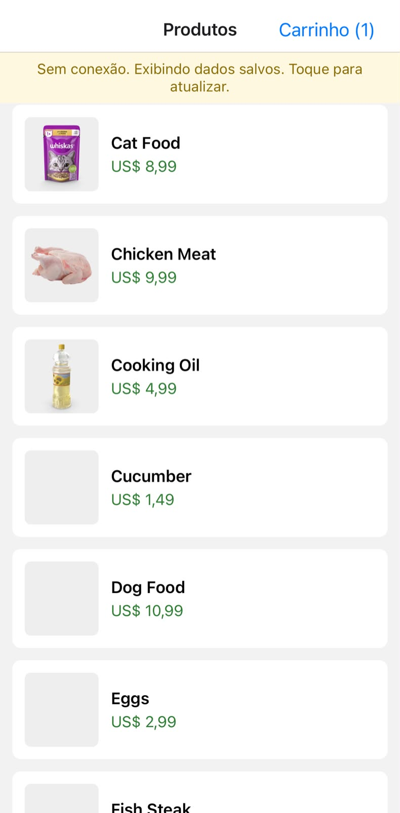
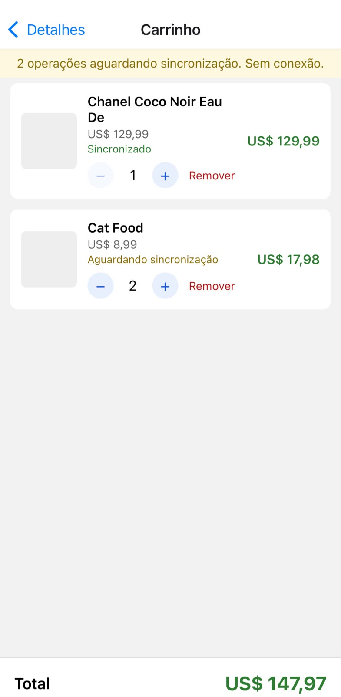
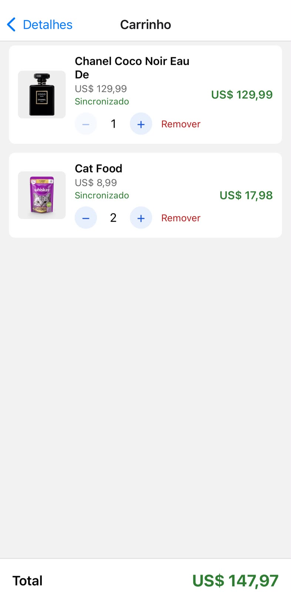

# Desafio Técnico Mobile: Sempher Solutions

Aplicativo mobile de consulta de produtos e carrinho de compras que funciona **online e offline**. Os dados ficam salvos em SQLite no aparelho, e as inclusões no carrinho são sincronizadas com uma API REST assim que há conexão.

## Objetivo

Desenvolver, com React Native e JavaScript, um app que:

- consulta produtos em uma API REST e os guarda localmente para uso sem internet;
- gerencia um carrinho persistido em SQLite;
- continua funcionando sem conexão, guardando as operações pendentes e enviando-as à API quando a internet voltar, sem duplicar envios.

A API usada é a [DummyJSON](https://dummyjson.com), sugerida no desafio. Ela **simula** as operações de escrita e não guarda nada no servidor, então o SQLite é a fonte de verdade dos dados do carrinho, e a resposta de sucesso da API representa a confirmação simulada da operação.

## Funcionalidades

**Produtos**
- Listagem com nome, imagem e preço, paginada de 20 em 20 (carrega mais ao rolar) e com "puxar para atualizar".
- Tela de detalhes com imagem, nome, preço, categoria e descrição.
- Cada produto consultado é salvo no SQLite. Sem conexão, a lista e os detalhes aparecem a partir dos dados salvos, com um aviso. As imagens já vistas online ficam em cache no aparelho e continuam aparecendo offline.

**Carrinho**
- Adicionar produtos, alterar a quantidade e remover itens.
- Total calculado e contador de itens no cabeçalho.
- O carrinho continua o mesmo depois de fechar e abrir o app.
- Cada item mostra se já foi sincronizado ("Sincronizado") ou se ainda aguarda ("Aguardando sincronização").

**Online e offline**
- Com conexão: cada inclusão no carrinho é enviada à API (`POST /carts/add`) e o estado local é atualizado conforme o resultado.
- Sem conexão: a operação fica guardada no SQLite como pendente, e o app segue funcionando normalmente.
- Ao reconectar: as pendentes são enviadas na ordem em que foram criadas, sem reenviar as que já foram sincronizadas.

**Erros e avisos**
- Mensagens claras para falhas de conexão e erros do servidor. Ao reconectar, a lista, os detalhes e as operações pendentes se atualizam sozinhos; os avisos continuam tocáveis para tentar de novo na hora.
- Aviso permanente no carrinho com a quantidade de operações aguardando sincronização, e se o app está sem conexão.
- Falhas na sincronização mantêm a operação na fila para nova tentativa. Depois de 5 erros do servidor, a operação é marcada como falha, o usuário é avisado e pode reenviá-la com um toque.

## Tecnologias

| Item | Uso |
| --- | --- |
| JavaScript | Linguagem (sem TypeScript) |
| React Native 0.88 e React 19 | Interface, com componentes funcionais e hooks |
| Expo SDK 58 | Execução e ferramentas de desenvolvimento (Expo Go) |
| `expo-sqlite` | Persistência local |
| `@react-native-community/netinfo` | Detecção de conectividade |
| `expo-crypto` | Identificador único (UUID) de cada operação |
| `expo-image` | Imagens com cache em disco, para exibição offline |
| React Navigation (native stack) | Navegação entre telas |
| Context API | Estado compartilhado (carrinho e conectividade) |
| `fetch` | Chamadas HTTP, com tempo limite de 10 segundos |
| Git e GitHub | Versionamento, com commits pequenos no padrão `tipo: descrição` |

## Como executar

### Pré-requisitos

- [Node.js](https://nodejs.org) (desenvolvido com a v24.11.0) e npm
- [Git](https://git-scm.com)
- O app **Expo Go** no celular (App Store ou Google Play), com o celular na **mesma rede Wi-Fi** do computador

### Instalação e execução

```bash
git clone https://github.com/JoaoRibeiro2005/desafio-mobile-sempher.git
cd desafio-mobile-sempher
npm install
npx expo start
```

Depois, escaneie o QR code exibido no terminal: com a câmera do iPhone, ou pelo próprio Expo Go no Android.

### Configuração

Nenhuma. A API é pública e não exige chave, e o projeto não usa variáveis de ambiente nem credenciais. O banco SQLite (`sempher.db`) é criado automaticamente na primeira abertura.

### Problemas comuns

- **"You need to be signed in to Expo Go and Expo CLI":** entre com a mesma conta Expo no Expo Go e no terminal (`npx expo login`). A conta é gratuita.
- **O app não abre pelo QR code:** confirme que o celular e o computador estão na mesma rede Wi-Fi.
- **Testar o modo offline:** com o app já aberto, ative o modo avião do celular. Não recarregue o app com o modo avião ligado, porque o Expo Go busca o código no computador.
- O app foi testado em um iPhone, pelo Expo Go. O Android não foi testado.
- **"Project is incompatible with this version of Expo Go":** o projeto usa o Expo SDK 58. O Expo Go precisa suportar essa versão. Se a versão da loja for mais nova, é possível instalar uma versão compatível do Expo Go pelo site do Expo ou rodar o app em um emulador com `npx expo start` e a tecla `a` (Android) ou `i` (iOS, só em Mac).

## Persistência local (SQLite)

O banco fica no armazenamento privado do app, sobrevive ao fechamento e é criado em `src/database/db.js`. Datas são guardadas como texto no formato ISO.

### `products`: cache dos produtos consultados

| Coluna | Tipo | Observação |
| --- | --- | --- |
| `id` | INTEGER | Chave primária (o mesmo id da API) |
| `title` | TEXT | Obrigatório |
| `description` | TEXT | |
| `price` | REAL | Obrigatório |
| `thumbnail` | TEXT | Endereço da imagem |
| `category` | TEXT | |
| `updated_at` | TEXT | Quando foi salvo ou atualizado |

Os produtos são gravados com `INSERT OR REPLACE`, então consultar de novo atualiza o cache sem duplicar linhas.

### `cart_items`: carrinho

| Coluna | Tipo | Observação |
| --- | --- | --- |
| `product_id` | INTEGER | Chave primária: um item por produto |
| `title`, `price`, `thumbnail` | TEXT, REAL, TEXT | Cópia dos dados do produto no momento da adição |
| `quantity` | INTEGER | Obrigatório, com `CHECK (quantity > 0)` |
| `sync_status` | TEXT | `pending` ou `synced` (padrão `pending`) |
| `created_at`, `updated_at` | TEXT | A ordem dos itens segue `created_at` |

O item guarda uma cópia dos dados do produto, então o carrinho continua completo mesmo que o produto não esteja no cache. Adicionar um produto que já está no carrinho soma a quantidade (`ON CONFLICT ... DO UPDATE`).

### `pending_operations`: fila de sincronização

| Coluna | Tipo | Observação |
| --- | --- | --- |
| `id` | INTEGER | Autoincrementado: define a ordem de envio |
| `operation_uuid` | TEXT | UUID v4 da operação, `UNIQUE` |
| `type` | TEXT | Hoje só `ADD_TO_CART` |
| `payload` | TEXT | JSON com `userId`, `productId` e `quantity` |
| `status` | TEXT | `pending`, `syncing`, `synced` ou `failed` (com `CHECK`) |
| `attempts` | INTEGER | Tentativas que terminaram em erro do servidor |
| `last_error` | TEXT | Mensagem do último erro |
| `created_at`, `synced_at` | TEXT | Criação e confirmação da API |

A operação guarda os dados do que deve ser enviado (e não uma referência ao item), porque o carrinho pode mudar depois do toque.

## Sincronização

### Fluxo

1. **Adicionar ao carrinho.** Em uma única transação, o app grava o item em `cart_items` e a operação em `pending_operations` (`pending`). Ou as duas gravações acontecem, ou nenhuma. A tela atualiza na hora, sem esperar a rede.
2. **Tentar enviar.** Logo depois, o `syncService` tenta enviar as operações pendentes para `POST /carts/add`, na ordem do `id`, com o corpo `{ "userId": 1, "products": [{ "id": ..., "quantity": ... }] }`.
3. **Sem conexão.** O envio falha, a operação volta para `pending` (sem gastar tentativa) e o app para de tentar as seguintes, porque também falhariam.
4. **Conexão de volta.** O NetInfo avisa a mudança e a sincronização roda sozinha. Ela também roda ao abrir o app, depois de cada adição e quando o usuário toca no aviso de pendentes.
5. **Sucesso.** A operação vira `synced` (com `synced_at`) e, se o item não tem mais operações em aberto, ele passa a "Sincronizado". As duas mudanças acontecem na mesma transação.



### Como se evita o envio duplicado

- Só operações `pending` são enviadas, e `synced` nunca volta para `pending`.
- **Reserva atômica:** antes de enviar, a operação passa de `pending` para `syncing` com `UPDATE ... WHERE id = ? AND status = 'pending'`. Só quem conseguir a mudança (uma linha afetada) pode enviá-la.
- **Uma sincronização por vez:** uma trava impede execuções simultâneas. Se chegar um pedido durante uma sincronização, ela confere a fila de novo ao terminar, para não perder operações recém-criadas.
- O `operation_uuid` é `UNIQUE`, então a mesma operação não entra duas vezes na fila.
- As transações do SQLite rodam em série, porque o SQLite não aceita abrir uma transação dentro de outra (toques rápidos poderiam causar isso).

### Tratamento de falhas

- **Sem conexão:** não gasta tentativa. Ficar offline por muito tempo não faz as operações desistirem.
- **Erro do servidor:** gasta uma tentativa. Na quinta, a operação vira `failed`, sai da contagem de pendentes e aparece em um aviso vermelho no carrinho, com um toque para reenviar (as tentativas voltam a zero).
- **App fechado no meio do envio:** na abertura, o que ficou em `syncing` volta para `pending` e é enviado de novo.
- **Remover um item** descarta as operações dele que ainda não foram enviadas (`pending` ou `failed`).
- Nenhuma operação é perdida: todas ficam no SQLite até serem sincronizadas ou descartadas pelo usuário.

## Estrutura do projeto

```
App.js                           providers e navegação
src/
  screens/                       ProductListScreen, ProductDetailScreen, CartScreen
  components/                    ProductCard, CartItem, CartButton, StatusBanner
  context/                       CartContext, ConnectivityContext
  services/                      api, productsService, cartService, syncService
  database/                      db, productsRepository, cartRepository,
                                 pendingOperationsRepository
  utils/                         formatPrice
docs/                            planejamento e registro dos testes
```

As telas não falam direto com o banco nem com a API: elas chamam os **serviços**, que decidem quando usar a API ou o SQLite e usam os **repositórios**, que concentram o SQL.

## Decisões técnicas

- **Gravar localmente antes de enviar.** Toda adição passa pelo mesmo caminho (grava no SQLite e depois tenta enviar), em vez de ter um fluxo para online e outro para offline. O usuário nunca espera a rede, e há um só caminho para testar.
- **O NetInfo dispara a sincronização, mas não decide se ela funciona.** Quem decide é a resposta da API. O estado online começa otimista e só vira offline quando o NetInfo informa explicitamente `false`, porque a primeira tentativa de envio descobre a verdade.
- **Lista: API primeiro, SQLite como reserva.** Qualquer falha cai nos dados salvos. Se não há nada salvo para a página pedida, o erro original é mostrado.
- **Detalhes: SQLite primeiro, API depois.** A tela abre na hora com o que está salvo e se atualiza quando a API responde.
- **Context API em vez de Redux.** O estado compartilhado é pequeno (carrinho e conectividade), e a Context API resolve sem dependência extra.
- **Total calculado em centavos**, para evitar erros de arredondamento de decimais em JavaScript.
- **Atualizar sozinho ao reconectar.** A lista e os detalhes buscam de novo quando o NetInfo informa a volta da conexão, se estavam mostrando dados salvos ou uma falha. Operações com falha (5 erros do servidor) continuam com reenvio só manual, porque reconectar não resolve um erro do servidor.

## Limitações conhecidas

- **Entrega "pelo menos uma vez".** Se o app fechar depois de a API responder e antes de a operação ser marcada como `synced`, ela é enviada de novo na reabertura. Uma API real resolveria com um cabeçalho de idempotência usando o `operation_uuid`. Como a DummyJSON só simula as escritas, o identificador fica como controle local.
- **Só a inclusão no carrinho é enviada.** Alterar a quantidade ou remover itens acontece só no aparelho, então a quantidade enviada à API pode ser menor que a do carrinho. Uma evolução natural é criar outros tipos de operação na mesma fila.
- **Imagens offline.** As imagens ficam em cache de disco (`expo-image`). Aparecem offline só se já tiverem carregado online ao menos uma vez, e o sistema pode limpar esse cache para liberar espaço.
- **Operações com falha não são reenviadas automaticamente**, de propósito, para não repetir uma falha permanente. O reenvio é manual.
- **Sem login:** o carrinho é sempre do usuário `1`.
- **Sem testes automatizados.** Os fluxos foram verificados manualmente, e o registro está em `docs/TESTES.md`.

## Testes e documentação

- [`docs/PLANEJAMENTO.md`](docs/PLANEJAMENTO.md): planejamento do projeto e ajustes feitos durante a implementação.
- [`docs/TESTES.md`](docs/TESTES.md): testes manuais de cada etapa, com os resultados.
- [`docs/PREPARACAO_DOS_TESTES.md`](docs/PREPARACAO_DOS_TESTES.md): as alterações temporárias de código usadas para provocar falhas e cenários offline nos testes. Nenhuma delas faz parte do código entregue.

## Demonstração

<!-- Substitua as imagens em docs/imagens/ pelos seus prints e cole aqui o link do vídeo, se houver. -->

| Lista (online) | Detalhes | Carrinho (sincronizado) |
| --- | --- | --- |
|  |  |  |

| Lista offline | Carrinho offline | Depois de reconectar |
| --- | --- | --- |
|  |  |  |

O fluxo principal da demonstração: abrir a lista com internet, ligar o modo avião, ver a lista a partir dos dados salvos, adicionar um produto ao carrinho (o aviso mostra a operação pendente), desligar o modo avião e ver o item virar "Sincronizado".

**Vídeo:** [Demonstração dos fluxos online e offline](https://youtube.com/shorts/Mq2sP_pMfgQ?is=zeJPMz6FOAJl7azP)